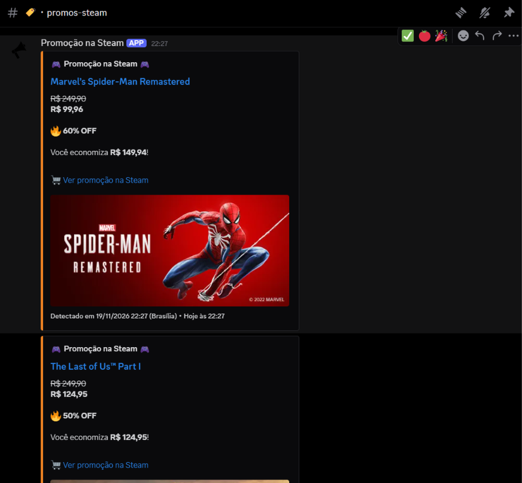

# Promoção na Steam 




Monitor automático de promoções da Steam. Consulta os preços dos jogos configurados na loja brasileira (BRL) e envia alertas para um canal do Discord quando o desconto atinge o mínimo definido para cada jogo. Roda no GitHub Actions, sem servidor dedicado ou banco de dados. O custo de execução depende da visibilidade do repositório e do plano do GitHub.

---

## Execução

O monitor roda sozinho a cada 30 minutos pelo GitHub Actions. Para executar na hora: aba **Actions** > **Steam Monitor** > **Run workflow**.

[Abrir as execuções do workflow](https://github.com/Jotshh/STEAM_ALERTS/actions)

---

## Tecnologias Utilizadas

* Python 3.12+
* [Requests](https://requests.readthedocs.io/) para as chamadas HTTP
* Steam Store API pública (`appdetails`)
* Discord Webhooks (embeds)
* GitHub Actions (agendamento e persistência do histórico)
* Pytest para os testes automatizados
* JSON para configuração e histórico

---

## Funcionalidades

- Monitoramento de vários jogos ao mesmo tempo, cada um com desconto mínimo próprio
- Adicionar, remover ou pausar jogos só editando `config/games.json`
- Alerta em embed do Discord com imagem, preço original, preço promocional, desconto, economia, link da Steam e horário
- Identidade do alerta no Discord: **Promoção na Steam**; o título do embed mostra também o nome do jogo
- Cor do embed muda conforme o tamanho do desconto
- Controle de duplicidade por App ID, desconto e estado da promoção
- Histórico em `data/alerts.json`, salvo pelo próprio workflow com commit automático só quando há mudança
- Menor preço observado por App ID e moeda, com data/hora e destaque de novo mínimo nos alertas
- Tentativa de novo envio na próxima execução se o Discord falhar

---

## Regras de Alerta

| Situação | Alerta? |
|---|---|
| Promoção nova (desconto igual ou acima do mínimo) | Sim |
| Desconto mudou, para mais ou para menos, ainda acima do mínimo | Sim, a qualquer momento |
| Mesmo desconto, menos de 7 dias desde o último alerta | Não |
| Mesmo desconto, 7 dias ou mais desde o último alerta | Sim |
| Desconto caiu abaixo do mínimo ou a promoção acabou | Não, só atualiza o estado |
| Nova promoção depois de uma encerrada | Sim |

---

## Histórico de Menor Preço

Em cada consulta válida de um jogo com preço pago, o monitor registra em `data/alerts.json`
o menor preço observado, em centavos, junto da moeda e da data/hora. Esse registro é
atualizado mesmo quando o desconto fica abaixo do mínimo configurado para alertas.

Quando o preço atual fica abaixo do mínimo já observado na mesma moeda, o embed destaca
**NOVO MENOR PREÇO REGISTRADO** e mostra o preço anterior. Se o preço atual estiver acima
do mínimo salvo, o embed informa que o jogo já foi encontrado por um preço inferior.
Na primeira observação, o alerta deixa claro que se trata do primeiro preço visto pelo
monitor — não de um recorde histórico da Steam.

Cada moeda mantém um histórico independente: o monitor não converte nem compara moedas
diferentes e não apaga o registro anterior quando a moeda da consulta muda. Consultas com
erro, jogo indisponível, preço ausente/inválido e jogos gratuitos não alteram o histórico.
Os dados novos são armazenados junto aos campos existentes por App ID no próprio
`data/alerts.json`, sem exigir migração ou remoção do arquivo.
Se o envio de um alerta de novo recorde falhar, o evento fica pendente no mesmo JSON e é
reapresentado no próximo envio elegível; após o envio bem-sucedido, a pendência é removida.

---

## Estrutura do Projeto

```
STEAM_ALERTS/
├── .github/workflows/steam-monitor.yml
├── src/
│   └── steam_alert/
│       ├── main.py
│       ├── steam_client.py
│       ├── deal_detector.py
│       ├── alert_manager.py
│       ├── discord_client.py
│       └── logger.py
├── config/
│   └── games.json
├── data/
│   └── alerts.json
├── tests/
├── .env.example
├── .gitignore
├── pytest.ini
├── requirements.txt
└── requirements-dev.txt
```

---

## Como Usar

### 1. Criar o webhook do Discord

Configurações do Canal > Integrações > Webhooks > Novo Webhook > Copiar URL do Webhook. Trate a URL como senha.

### 2. Configurar o secret no GitHub

**Settings > Secrets and variables > Actions > New repository secret**:

- Name: `DISCORD_WEBHOOK_URL`
- Secret: a URL copiada

Em **Settings > Actions > General > Workflow permissions**, selecione **Read and write permissions** para o workflow poder atualizar o histórico. O workflow também declara `contents: write` no YAML.

### 3. Escolher os jogos

Abra [`config/games.json`](./config/games.json) e adicione um objeto dentro da lista.

1. Acesse a página do jogo na Steam.
2. Copie o número que aparece depois de `/app/` na URL. Por exemplo, em `store.steampowered.com/app/1245620/` o App ID é `1245620`.
3. Use o nome que deseja ver nos alertas do Discord.
4. Defina `min_discount` com o desconto mínimo que deve gerar um alerta.
5. Mantenha `enabled` como `true` para ativar o jogo.

Exemplo com Elden Ring:

```json
[
  {
    "name": "Elden Ring",
    "appid": 1245620,
    "min_discount": 20,
    "enabled": true
  }
]
```

Ao adicionar outros jogos, separa cada objeto por uma vírgula:

```json
[
  {
    "name": "Elden Ring",
    "appid": 1245620,
    "min_discount": 20,
    "enabled": true
  },
  {
    "name": "Stardew Valley",
    "appid": 413150,
    "min_discount": 30,
    "enabled": true
  }
]
```

- `name`: nome exibido nos logs e nos alertas.
- `appid`: número inteiro positivo da página do jogo na Steam. Não use o nome do jogo no lugar do número.
- `min_discount`: desconto mínimo necessário, de `0` a `100`. O alerta só será enviado enquanto houver promoção ativa.
- `enabled`: `true` monitora o jogo; `false` pausa o monitoramento sem precisar removê-lo.
- Cada App ID deve aparecer uma única vez no arquivo.
- Ao remover um jogo, exclua seu objeto completo e ajuste a vírgula do item anterior ou seguinte.

### 4. Executar localmente

```bash
python -m venv .venv && source .venv/bin/activate
pip install -r requirements-dev.txt
cp .env.example .env
export PYTHONPATH=src
python -m steam_alert.main --dry-run   # consulta e decide, sem enviar nem gravar
python -m steam_alert.main
```

### 5. Rodar os testes

```bash
python -m pip install -r requirements-dev.txt
python -m pytest
```

---

## Segurança e Qualidade

- A URL do webhook vem só da variável `DISCORD_WEBHOOK_URL` e nunca aparece em logs ou erros
- No GitHub, guarde a URL em **Settings > Secrets and variables > Actions** como `DISCORD_WEBHOOK_URL`; não coloque o valor real no YAML nem em `games.json`
- Validação do `games.json` e do `alerts.json`; arquivo corrompido interrompe a execução em vez de ser sobrescrito
- Timeout, retry com backoff e pausa entre requisições à Steam
- Tratamento de limite de requisições (429) do Discord
- `concurrency` no workflow evita execuções simultâneas
- Permissões mínimas: apenas `contents: write`
- Lógica de decisão separada das integrações externas, com testes usando mocks
- Os runners padrão do GitHub são gratuitos para repositórios públicos; em repositórios privados, o uso segue a franquia e as regras de cobrança do plano

---

## Limitações

- A API `appdetails` da Steam não é oficialmente documentada e pode mudar ou limitar requisições
- O cron do GitHub pode atrasar em horários de pico
- Em repositório público, o GitHub desativa workflows agendados após 60 dias sem atividade
- Em repositório privado, o plano gratuito tem 2.000 minutos/mês

---

## Licença

Este projeto está licenciado sob a MIT License.

---

## Contribuições

Leia o guia em [CONTRIBUTING.md](./CONTRIBUTING.md) para configurar o ambiente, executar testes e enviar alterações.

---

## Suporte

Email: josiephelipel265@gmail.com

GitHub: [@Jotshh](https://github.com/Jotshh)